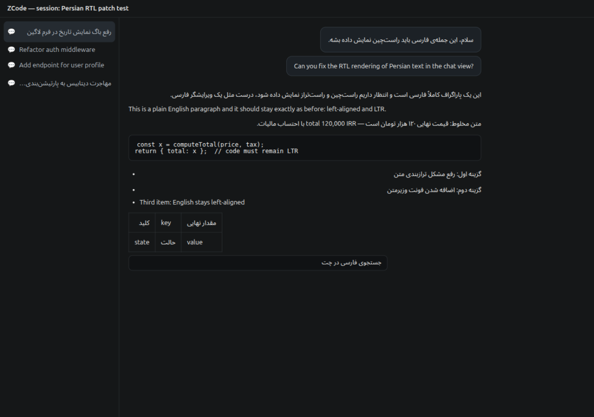

# ZCode-RTL-Patch

Per-block auto-RTL for Persian text in the **ZCode desktop app** — Persian blocks render
right-to-left, English stays exactly as it is. No app source changes, one local CSS patch,
fully reversible.

پچ راست‌چین‌شدن خودکار متن فارسی در اپ دسکتاپ **ZCode** — بلاک‌های فارسی راست‌چین نمایش داده
می‌شوند و انگلیسی دست‌نخورده می‌ماند. بدون تغییر سورس اپ، فقط یک پچ CSS محلی و کاملاً بازگشت‌پذیر.



---

## English

### What it does

The ZCode desktop app ships no RTL support at all (its UI is English/Chinese only), so
Persian text in chats and session titles renders left-aligned with wrong bidi ordering.
This patch injects one CSS rule into the app's renderer entry (`out/renderer/index.html`
inside `app.asar`):

```css
#root :is(p, li, h1, h2, h3, h4, h5, h6, td, th, blockquote, figcaption, dd, dt),
#root .truncate,
#root :is(input, textarea),
#root div:not(:has(*)):not(:empty) {
  unicode-bidi: plaintext;
  text-align: start;
}
```

`unicode-bidi: plaintext` is the standard CSS way to make **every block resolve its own
direction from its first strong character** (UAX #9 rules P2/P3). That gives exactly the
behavior you want in a mixed Persian/English chat:

| Content | Rendering after patch |
|---|---|
| Persian paragraph / list item / table cell | RTL, right-aligned |
| English paragraph | LTR, left-aligned — pixel-identical to before |
| Mixed paragraph | correct bidi ordering, aligned by its first strong character |
| Code blocks, diffs, terminal (xterm), Monaco | untouched (LTR) |
| Session titles (`.truncate`), text inputs | Persian titles/values right-aligned |
| App chrome, icons, layout | untouched — layout stays LTR, nothing reflows |

HTML/PDF/Office previews run in separate webContents, so your generated artifacts are
**not** affected.

### Quick start

```bash
git clone https://github.com/SOMM-55/ZCODE-RTL-Patch.git
cd ZCODE-RTL-Patch

# patch the installed app (creates a pristine backup first)
sudo node patch.js apply

# then fully quit and restart ZCode
```

Requirements: Linux, Node.js, and ZCode installed at `/opt/ZCode` (the default location).
`sudo` is only needed because `/opt/ZCode` is root-owned.

### Commands

| Command | What it does |
|---|---|
| `sudo node patch.js apply` | patch the app; takes a one-time pristine backup |
| `sudo node patch.js revert` | restore the original file byte-for-byte |
| `node patch.js check` | show patch state (read-only, no sudo) |
| `node patch.js --asar PATH apply` | operate on a custom asar path |
| `node patch.js --help` | usage text |

`apply` is idempotent and verifies its own work: it refuses to write unless the change is
byte-length-equal and confined to the `index.html` range. See
[docs/HOW-IT-WORKS.md](docs/HOW-IT-WORKS.md) for the full technical story.

### After a ZCode update

App updates replace `app.asar`, so simply run `sudo node patch.js apply` again. The script
re-locates the renderer entry and re-verifies the structure; if a future version changes
too much, it aborts without writing. (If you have ZCode auto-update enabled, also re-apply
after every update; if disabled, the patch persists until you revert it.)

### Troubleshooting / FAQ

- **Nothing changed after apply.** Did you fully restart ZCode (quit from the tray too)?
- **How do I undo it?** `sudo node patch.js revert`, then restart. The backup
  `/opt/ZCode/resources/app.asar.orig-backup` is byte-identical to the original installer
  file.
- **Does it touch the app's code or telemetry?** No. It rewrites only the bytes of
  `out/renderer/index.html`, same size, and only to append a `<style>` rule. The asar
  header (all file entries, offsets, hashes) stays byte-identical.
- **Will my English UI change?** No — English text resolves LTR under
  `unicode-bidi: plaintext`, which is the same as before. Centered/justified English text
  inside chat markdown may left-align (rare; `text-align: start`).
- **Known limitation.** List bullets of Persian items stay on the left side (markers follow
  the container's layout direction, which stays LTR by design). Text itself is right-aligned.
- **Custom install path?** Run with `--asar /path/to/app.asar`.

---

## فارسی

### مشکل چی بود

اپ دسکتاپ ZCode هیچ پشتیبانی RTL نداره (UI فقط انگلیسی/چینه)، برای همین متن فارسیِ چت‌ها و
عنوان سشن‌ها چپ‌چین و با ترتیب بی‌دی اشتباه نمایش داده می‌شه. این پچ یک قانون CSS به نقطه‌ی
ورود رندرر اپ اضافه می‌کنه تا **هر بلاک متنی جهت خودش رو از اولین حرف قویِ خودش تشخیص بده**
(`unicode-bidi: plaintext`) — یعنی دقیقاً «بلاک‌های فارسی راست‌چین، انگلیسی دست‌نخورده».

### نصب سریع

```bash
git clone https://github.com/SOMM-55/ZCODE-RTL-Patch.git
cd ZCODE-RTL-Patch

sudo node patch.js apply     # بکاپ یک‌باره از فایل اصلی هم می‌گیره

# بعدش ZCode را کامل ببندید و دوباره باز کنید
```

پیش‌نیاز: لینوکس، Node.js و نصب بودن ZCode در مسیر پیش‌فرض `/opt/ZCode`. رمز sudo فقط به این
دلیل لازمه که فایل‌های اپ متعلق به root هستند.

### دستورها

| دستور | کار |
|---|---|
| `sudo node patch.js apply` | اعمال پچ + بکاپ یک‌باره از فایل اصلی |
| `sudo node patch.js revert` | برگرداندن فایل اصلی بایت‌به‌بایت |
| `node patch.js check` | نمایش وضعیت پچ (بدون تغییر، بدون sudo) |
| `node patch.js --asar PATH apply` | پچ روی مسیر دلخواه |
| `node patch.js --help` | راهنما |

### نکته‌ها

- **بعد از هر آپدیت ZCode** یک بار دیگر `apply` را اجرا کنید (آپدیت، `app.asar` را عوض
  می‌کند). اگر auto-update خاموش باشد، پچ تا وقتی خودتان `revert` نکنید می‌ماند.
- بلوک‌های کد، دیف‌ها، ترمینال و ادیتورها LTR می‌مانند؛ پنل‌های پیش‌نمایش (HTML/PDF/Office)
  پنجره‌ی جداشان و تأثیری نمی‌پذیرند.
- چیدمان کلی اپ همچنان LTR است؛ فقط متن‌های فارسی راست‌تراز می‌شوند، پس چیزی در UI به‌هم
  نمی‌ریزد.
- محدودیت شناخته‌شده: بولتِ آیتم‌های لیست فارسی سمت چپ می‌ماند و فقط متن راست‌چین می‌شود.
- برای برگشت: `sudo node patch.js revert` و بعد ری‌استارت اپ.

---

## Demo / تسته محلی

`demo/demo.html` is a self-contained page that mimics the chat UI with the exact injected
rule — open it in any Chromium browser to see the behavior without touching your install.
`demo/demo.html` یک صفحه‌ی مستقل است که رفتار قانون تزریق‌شده را شبیه‌سازی می‌کند؛ بدون دست
زدن به نصب‌تان در هر مرورگر Chromium بازش کنید.

## Compatibility

- Tested against **ZCode 3.14.4** (Electron 41 / Chromium 146) on Linux.
- Anything close should work: the script locates `out/renderer/index.html` dynamically and
  validates the structure before writing; it refuses to touch files it doesn't understand.
- Windows/macOS are not supported (asar integrity validation is enforced there, and paths
  differ).

## Security notes

The script runs locally, requires no network, and changes exactly one file inside your
ZCode install (plus one backup). It never phones home, and the repo contains no binaries —
read `patch.js` (~250 lines) before running it with sudo; that's the point of open source.

## Disclaimer

This is an unofficial community patch and is not affiliated with or endorsed by ZCode. Use
at your own discretion — `revert` always restores the original file.

## License

[MIT](LICENSE) © SOMM-55
